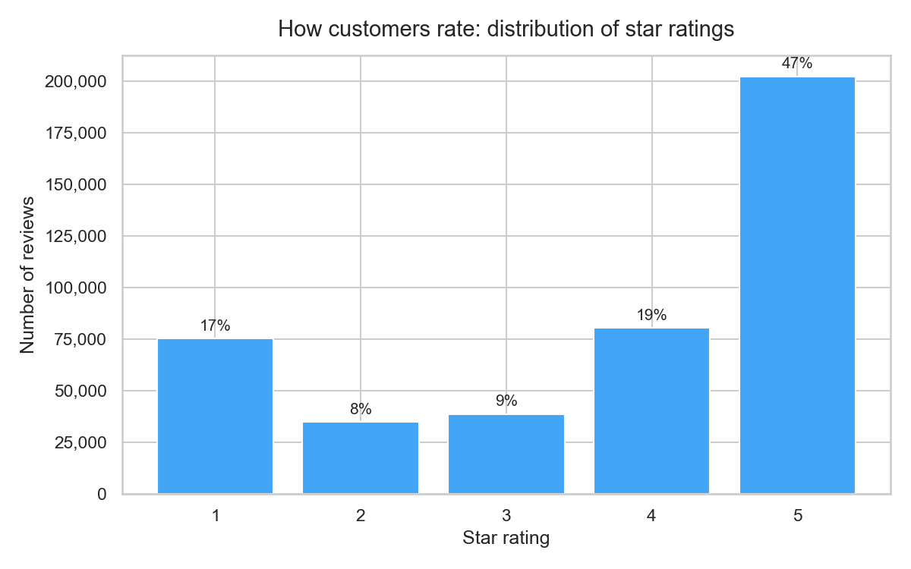
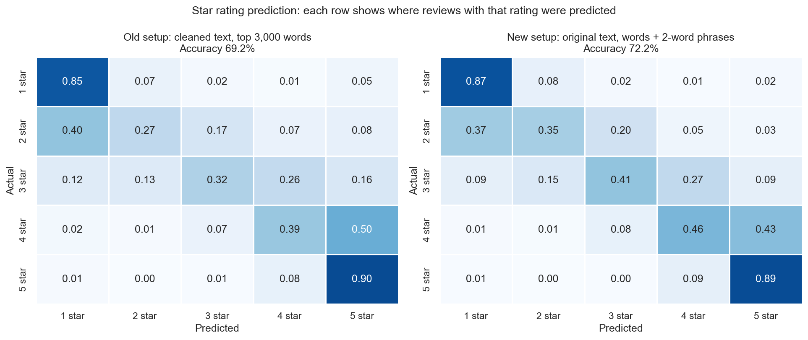
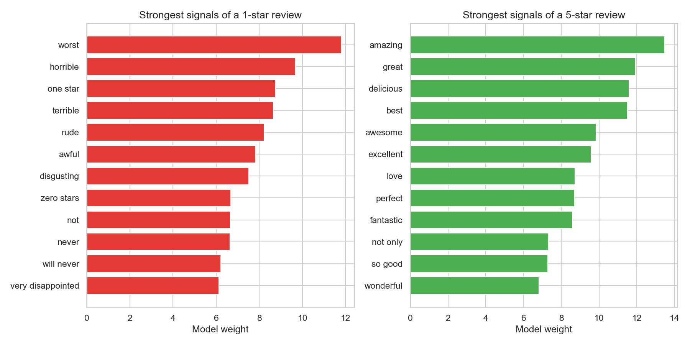
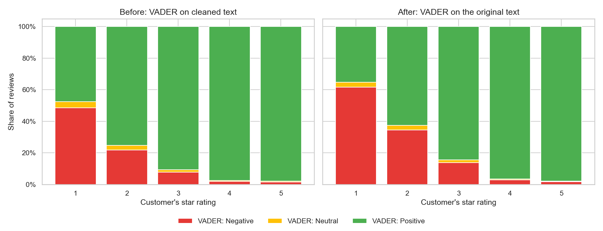
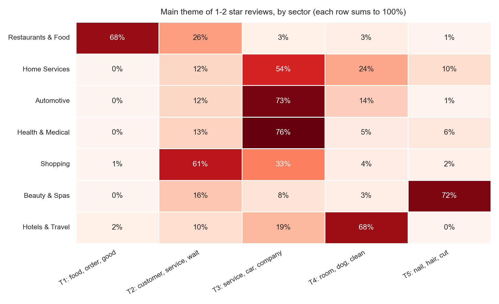
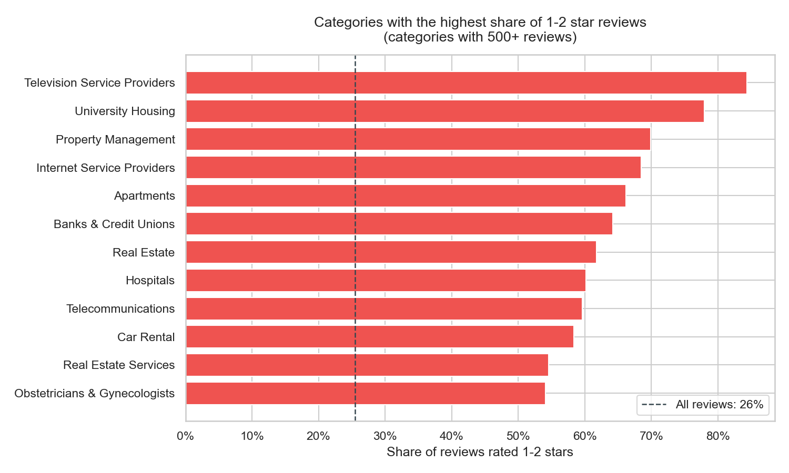
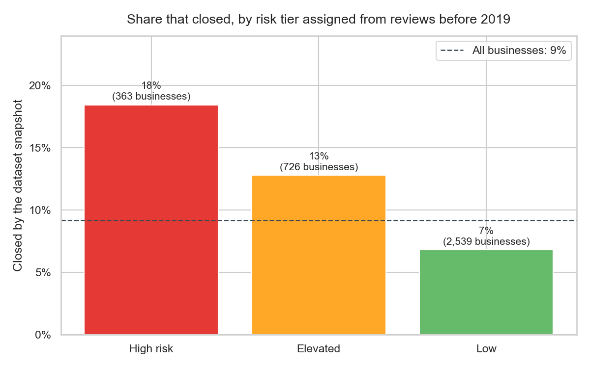
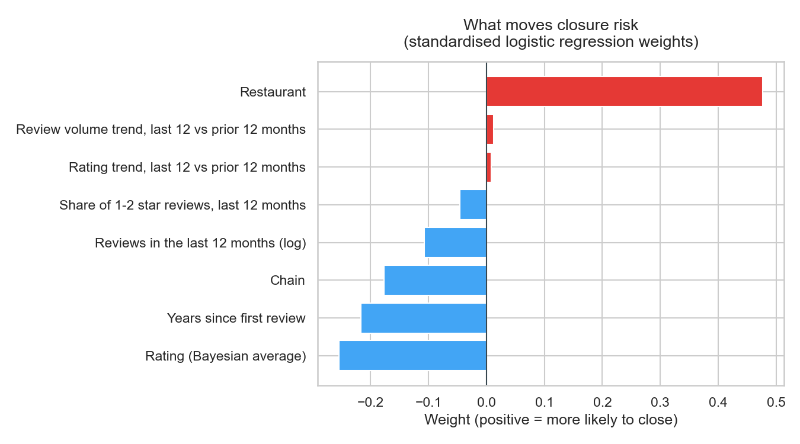
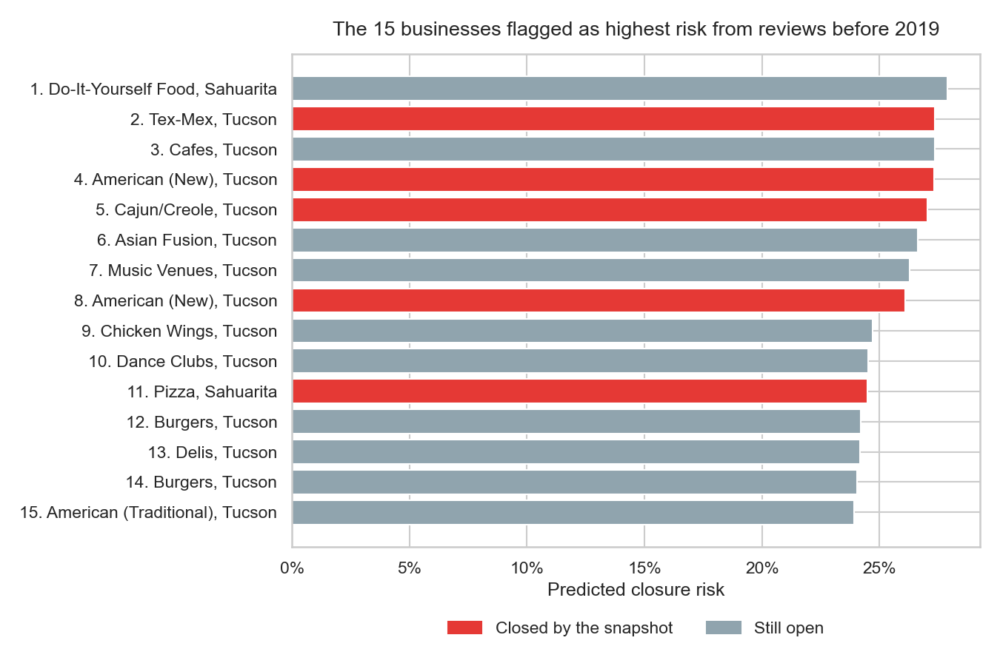
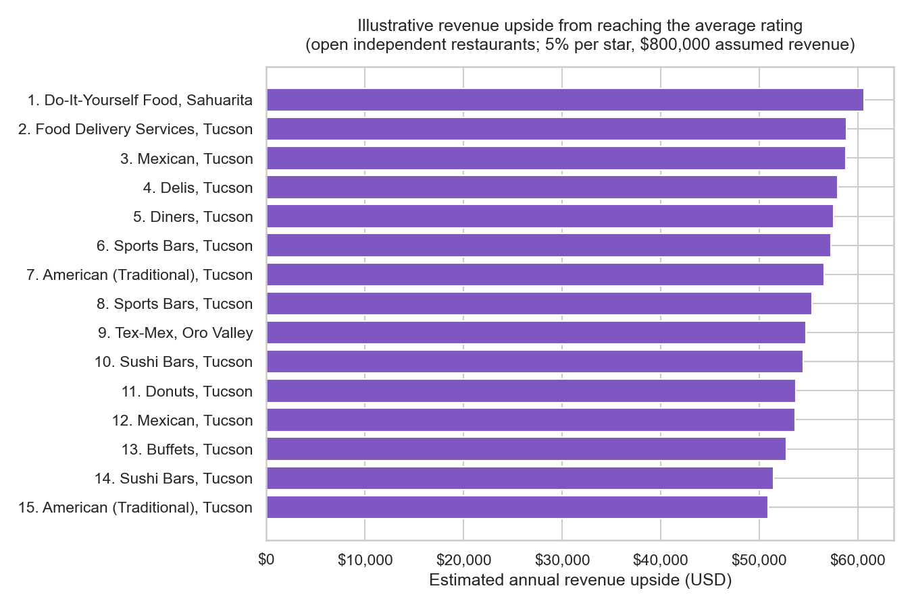

# Yelp Arizona: What 431,708 Reviews Say, and What They Don't

Text mining and machine learning on the Arizona businesses in the
[Yelp Open Dataset](https://www.yelp.com/dataset): 431,708 reviews of 9,912
businesses in the Tucson area. Three questions:

1. How well does review text predict the star rating?
2. What do 1-2 star reviews complain about, and does it differ by industry?
3. Do review signals warn that a business is about to close?

Built for BANA 572 (Machine Learning & Text Mining) at Oregon State University,
then revised in October 2026 (see [What changed](#what-changed-from-the-first-version)).

## Key findings

- **Text predicts ratings well.** TF-IDF logistic regression gets 72.2% of 1-5 star
  ratings exactly right, against 46.9% for always guessing 5 stars, and lands within
  one star 95.8% of the time. It flags 1-2 star reviews with 88% recall and 88% precision.
- **Lexicon sentiment misses nearly half the complaints.** Even after fixing its
  preprocessing, VADER labels 44% of 1-2 star reviews as positive. The supervised
  model catches 88% of them.
- **Ratings barely predict closures.** Backtested against 333 real closures, ratings
  alone scored an AUC of 0.55, where 0.5 is chance. Adding business type, age and activity
  raised it to 0.62, and the riskiest 10% of businesses closed at twice the average
  rate. Being a restaurant was the strongest signal.
- **Complaints mostly follow the industry.** Food drives restaurant complaints;
  appointments, billing and repairs drive medical, auto and home-service complaints.
  Rude or slow staff is the one theme that cuts across sectors (24% of complaints).

## Data

The 431,708 Arizona reviews in the Yelp Open Dataset, joined to their businesses.
Ratings skew high: 46.9% of reviews give 5 stars, and 25.5% give 1 or 2.



---

## 1. Predicting the star rating from text

80/20 stratified split (345,366 training and 86,342 test reviews). The TF-IDF vocabulary
is learned from training reviews only, and the regularisation strength (C = 2) was
picked on a validation slice of the training data.

| Model (test set) | Accuracy | Within 1 star | Mean error | Flags 1-2 star reviews: recall | Precision |
|---|---|---|---|---|---|
| Always guess 5 stars | 46.9% | 65.5% | 1.31 stars | - | - |
| First version: cleaned text, top 3,000 words | 69.2% | 93.0% | 0.42 stars | 84.3% | 84.9% |
| **Original text, words + 2-word phrases** | **72.2%** | **95.8%** | **0.34 stars** | **87.9%** | **88.2%** |

- **The extremes are easy and the middle is hard.** The model gets 87% of 1-star and
  89% of 5-star reviews right, but only 35-46% of 2, 3 and 4-star reviews, which it
  mostly confuses with their neighbours.
- **Negations carry signal.** "not", "will never" and "very disappointed" are among the
  strongest 1-star signals. The first version's cleaning deleted "not", "will" and
  "very" before modelling. "not only" is a 5-star signal.
- **Many of its worst misses are label noise.** The model's most confident mistakes
  are largely reviews whose stars contradict their own text, such as 5 stars on a
  review that opens "worst place ever".





## 2. How reliable is lexicon sentiment (VADER)?

VADER is a rule-based sentiment scorer built for raw, informal text: it reads
negations ("not good"), contrast ("but"), intensifiers ("very"), capitals and "!".
The first version ran it on text that had already been stripped of stopwords, and
NLTK's stopword list includes "not", "no", "nor", "but" and "very". "The food was
not good and the service was not friendly" became "food good service friendly", which
scores as positive.

Checked against what customers actually rated:

| | Before: VADER on cleaned text | After: VADER on original text |
|---|---|---|
| 1-2 star reviews labelled negative | 40.0% | 53.1% |
| 1-2 star reviews labelled positive | 56.3% | 43.9% |
| Agreement with the star rating (negative / neutral / positive) | 74.4% | 77.5% |

The fix helps, but VADER still calls 44% of complaints positive. Long complaints
often contain positive words ("I wanted to love this place..."), and a word-level
lexicon adds them up. The supervised model in section 1 catches 88% of complaints.



## 3. What do 1-2 star reviews complain about?

LDA topic model on the 110,081 reviews rated 1-2 stars. The number of topics was chosen
by NPMI coherence, which measures whether a topic's top words actually appear together
in reviews: 5 topics scored highest (0.180) of the 4-12 tried; the next best was 6 (0.156).

| Theme | Share of complaints | Typical words | Where it dominates |
|---|---|---|---|
| Food and the meal | 41.7% | food, order, taste, chicken, table | Restaurants (68% of their complaints) |
| Rude or slow staff | 24.0% | customer, service, wait, manager, rude, minute | Shopping (61%); also 26% of restaurant complaints |
| Appointments, billing and repairs | 19.6% | car, company, phone, appointment, pay, charge | Health & Medical (76%), Automotive (73%), Home Services (54%) |
| Rooms and property condition | 9.2% | room, clean, stay, hotel, door, water | Hotels & Travel (68%) |
| Hair and nail results | 5.6% | nail, hair, cut, color, salon | Beauty & Spas (72%) |

Across all businesses, the topics mostly separate industries. The exception is staff
behaviour, which shows up everywhere. Modelling one sector at a time would likely surface
sharper themes within it (for restaurants: wait times, wrong orders, food quality).



The categories with the highest share of 1-2 star reviews are mostly services that
customers can't easily switch away from (all reviews: 25.5%):



## 4. Do reviews warn that a business will close?

A backtest against real outcomes:

1. Cutoff date: 1 January 2019. Every signal uses only reviews written before it.
2. Signals per business: rating (Bayesian average, so a handful of reviews can't swing
   it), share of 1-2 star reviews in the last 12 months, rating trend, review-volume
   trend, recent activity, years on Yelp, restaurant and chain flags.
3. Businesses clearly open at the cutoff: 5+ reviews and at least one in the last 90
   days, which gives 3,628 businesses.
4. Outcome: Yelp's open/closed flag at the dataset snapshot (January 2022). 333 had
   closed (9.2%). The window includes the pandemic.
5. Logistic regression, scored with 5-fold cross-validated AUC.

| Model | AUC |
|---|---|
| Ratings only (rating, recent 1-2 star share, rating trend) | 0.549 |
| All signals | 0.624 |

| Risk tier (out-of-fold predictions) | Businesses | Closed | Closure rate | vs average |
|---|---|---|---|---|
| High risk (top 10%) | 363 | 67 | 18.5% | 2.0x |
| Elevated (next 20%) | 726 | 93 | 12.8% | 1.4x |
| Low | 2,539 | 173 | 6.8% | 0.7x |

Ratings on their own barely beat chance. The model's strongest signal is being a
restaurant; higher-rated, older and chain businesses were less likely to close.
Of the 15 businesses flagged as highest risk, 5 closed, against an expected 1.4 at
the average rate. That makes review signals a weak early-warning tool on their own.







## 5. Revenue illustration: independent restaurants

Luca (Harvard Business School) estimated that one extra Yelp star lifts an
independent restaurant's revenue 5-9%, and found no effect for chains. Applying the
low end to the 1,097 open independent restaurants with 5+ reviews (a name at fewer
than 5 locations across the Yelp dataset counts as independent): 512 rate below the
average of 3.79 stars, and reaching the average would be worth a median $12,785 a year
each, assuming $800,000 in annual revenue. Revenue is assumed, not observed, so treat
this as illustrative.



---

## What changed from the first version

- **Star prediction:** the first README reported 94% accuracy; the pipeline's actual
  star-prediction accuracy was 69.2%. Results are now reported against a baseline, the
  TF-IDF vocabulary is learned from training data only (it was fitted before the
  train/test split), and the model reads the original text. Random Forest was dropped:
  it scored 56.8% and almost never predicted 2-4 stars.
- **Sentiment:** VADER now scores the original text instead of stopword-stripped text.
- **Complaint themes:** complaints are defined by the customer's own 1-2 star rating
  instead of VADER labels, and the number of topics is chosen by coherence instead of
  fixed. K-Means was dropped: it found 8 groups against LDA's 5, with no way to
  reconcile them.
- **Business health:** the first version's weighted score (sentiment, stars and review
  count with fixed 50/70 cut-offs) flagged half of all businesses and was never tested.
  It is replaced by the closure backtest in section 4.
- **Revenue:** the 5% per star estimate is now applied only to independent restaurants,
  the businesses Luca's study covers, instead of every business.

## Limitations

- One metro area on one platform; reviewers are a self-selected slice of customers.
- The open/closed flag is a single snapshot, the closure window includes the pandemic,
  and some closures may never have been recorded on Yelp.
- Star ratings are noisy labels: some reviewers pick stars that contradict their own text.
- Topics are mostly industry-level. Within-sector models would be more actionable.
- The revenue figures rest on an assumed revenue level and an effect estimated for
  Seattle restaurants.

## Running it

```bash
python -m venv .venv
.venv\Scripts\activate            # macOS/Linux: source .venv/bin/activate
pip install -r requirements.txt
python -m spacy download en_core_web_sm
```

Put the Yelp business and review CSVs in `data/` (see [data/README.md](data/README.md)),
then run everything from the repo root:

```bash
python run_all.py        # runs every step that isn't already up to date
python run_all.py 04     # reruns step 04 onwards
```

A full run took about 25 minutes on a laptop, reusing the first version's cleaned text
(lemmatising with spaCy adds more). Everything printed is also saved to
`outputs/run_log.txt`, and `outputs/RESULTS.md` collects all the numbers.

| Step | What it does |
|---|---|
| `00_check_env.py` | Checks every package loads before the long steps start |
| `01_merge_data.py` | Filters the dataset to Arizona and joins reviews to businesses (reads the review file in chunks) |
| `02_preprocess.py` | VADER on the original text; cleaned, lemmatised text for topic modelling |
| `03_sentiment_eda.py` | Rating distribution, VADER vs stars, most complaint-heavy categories |
| `04_topics.py` | LDA on 1-2 star reviews, topic count chosen by NPMI coherence |
| `05_star_predictor.py` | Star prediction vs baseline and the first version's setup |
| `06_closure_risk.py` | Closure backtest and the independent-restaurant revenue illustration |
| `07_summary.py` | Writes `outputs/RESULTS.md` |

Step 02 uses spaCy for lemmatisation. If the first version's output
(`data/vader_preprocessed_output.csv`) is present, step 02 reuses its cleaned text,
which uses identical cleaning, and skips spaCy.

## Project structure

```
yelp-az-sentiment/
├── src/            pipeline steps 00-07 and shared settings (common.py)
├── assets/         charts used in this README
├── data/           raw and intermediate data (git-ignored; see data/README.md)
├── outputs/        metrics, reports and logs (mostly git-ignored)
├── run_all.py
└── requirements.txt
```

## Author

Vachan Thambi Naveen, BANA 572 (Machine Learning & Text Mining), Oregon State University.

The Yelp dataset is subject to [Yelp's Dataset Terms of Use](https://www.yelp.com/dataset/documentation/terms);
it is not redistributed here.
